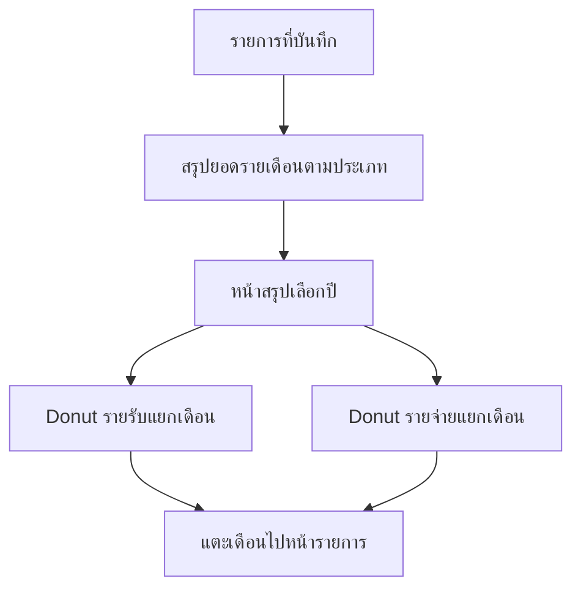
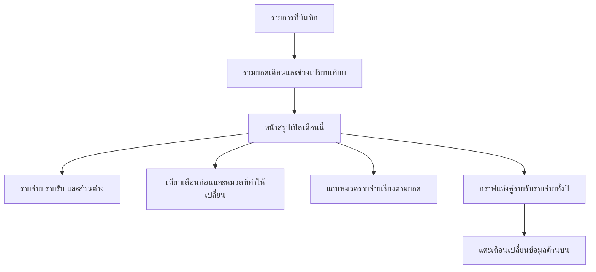

# Monthly Analytics Implementation Plan

> **For agentic workers:** Use the `executing-plans` skill to implement this plan task-by-task after user approval. Do not commit without completing `$ponytail-review` on the staged diff.

**Goal:** เปิดหน้าสรุปแล้วเข้าใจการใช้เงินเดือนนี้ ยอดตามหมวด และสาเหตุที่ต่างจากเดือนก่อน โดยใช้ข้อมูลบันทึกเดิม

**Architecture:** คงหน้า `/summary` และ schema เดิม เพิ่มการอ่านข้อมูลแบบ aggregate จาก SQLite และแยกกฎช่วงเวลา/การคำนวณเป็น pure functions ที่ทดสอบได้ หน้ารายการและการบันทึกยังทำงานตามเดิม ใช้ Svelte/SVG/CSS สำหรับกราฟโดยไม่เพิ่ม chart dependency

**Tech Stack:** Svelte 5, SvelteKit, TypeScript, SQLite, Tailwind CSS, Bun tests

**Spec:** ข้อกำหนดและแบบหน้าจอในเอกสารนี้ เป็นข้อเสนอสำหรับผู้ใช้ตรวจ ก่อนเริ่ม implementation

## Design and scope

เลือกแนวทาง monthly-first: ยอดเดือนที่เลือก → เทียบเดือนก่อน → หมวดรายจ่าย → แนวโน้มทั้งปี ใช้หน้าสรุปเดิมแทนการเพิ่ม dashboard ใหม่

แนวทางที่พิจารณา:
- Year-first: เปลี่ยน donut เป็นแท่งอย่างเดียว ทำเล็กกว่าแต่ยังไม่ตอบการเช็กเดือนนี้บ่อย ๆ
- Monthly-first (แนะนำ): ย้ายรายละเอียดเดือนมาอยู่บนสุด และคงกราฟปีเป็นบริบทด้านล่าง
- เพิ่มหน้า analytics ใหม่: แยกพื้นที่ได้มาก แต่เพิ่ม navigation และเกินขอบเขตรอบนี้

### Before — สถานะปัจจุบัน

### After — เป้าหมายหลัง implement

### Layout decisions

1. ตัวเลือกเดือนด้านบน: ก่อนหน้า/ถัดไป ชื่อเดือนและปี พร้อมทางกลับเดือนนี้เมื่อดูเดือนอื่น
2. ยอดรายจ่ายเด่นที่สุด ตามด้วยรายรับและ “รายรับหักรายจ่ายที่บันทึก” หลีกเลี่ยงคำว่าเงินในบัญชีหรือเงินออม
3. การ์ดเปรียบเทียบรายจ่าย: จำนวนบาทเพิ่ม/ลด เปอร์เซ็นต์ และช่วงวันที่ทั้งสองฝั่ง ใต้การ์ดบอกหมวดที่มีส่วนเพิ่ม/ลดมากที่สุดไม่เกิน 2 หมวด
4. หมวดรายจ่าย: แถบแนวนอนเรียงยอดมากไปน้อย ทุกหมวดแสดงชื่อ ยอดบาท และสัดส่วนจากรายจ่ายของเดือน/ช่วงที่แสดง ไม่มีการตัดเหลือ Top N หรือซ่อนหมวดอื่น
5. กราฟรายปี: แท่งคู่เขียว=รายรับ ส้ม=รายจ่าย ครบ 12 เดือน ใช้สเกลเดียวกันเริ่มที่ศูนย์ มีส่วนต่างสุทธิของแต่ละเดือนในรายละเอียดข้อความ และแสดงรายการตัวเลขที่เข้าถึงได้โดยไม่ต้อง hover เลือกเดือนแล้วเปลี่ยนรายละเอียดด้านบน
6. มือถือเป็นหลัก คงโทนอุ่นและมาสคอตเดิม ลดข้อความตกแต่งที่แย่งพื้นที่ข้อมูล กราฟปีใช้พื้นที่เลื่อนแนวนอนภายในการ์ดได้เมื่อจำเป็น ห้ามทำให้ทั้งหน้าล้น

## Global constraints and calculation rules

- ไม่เปลี่ยน schema, ไม่แก้ข้อมูลจริง, ไม่เพิ่มงบประมาณ การพยากรณ์ AI หรือระบบแจ้งเตือน
- จำนวนเงินคำนวณเป็น integer satang จนถึงขั้น format แสดงผล
- วันที่ปัจจุบันของ analytics ยึด `Asia/Bangkok` อย่างชัดเจน ไม่อาศัย timezone ของ server และไม่เปลี่ยน date helpers เดิมทั่วแอปในงานนี้
- URL หลัก `/summary?m=YYYY-MM`; ไม่มีหรือไม่ถูกต้องให้เปิดเดือนปัจจุบัน
- รองรับลิงก์เดิม `?y=YYYY` เมื่อไม่มี `m`: ปีปัจจุบันเปิดเดือนปัจจุบัน ปีอื่นเปิดมกราคมของปีนั้น; ถ้ามี `m` ที่ถูกต้องให้ `m` เป็นหลัก กราฟปีตามปีของเดือนที่เลือก
- เดือนปัจจุบัน: ยอด/หมวด/เปรียบเทียบใช้วันที่ 1 ถึงวันนี้ รวมวันนี้ ตัดรายการอนาคตออกจากช่วงนี้
- เทียบเดือนก่อนวันที่ 1 ถึงเลขวันเดียวกัน ถ้าไม่มีวันนั้นให้ใช้วันสุดท้ายของเดือนก่อน และแสดงวันที่จริงทั้งสองฝั่ง
- เดือนที่ผ่านมา: ยอดและหมวดเต็มเดือน เทียบเดือนก่อนเต็มเดือน ระบุว่า “เทียบเต็มเดือน”
- เดือนอนาคต: แสดงยอดที่บันทึกไว้เต็มเดือน พร้อมข้อความว่าเป็นเดือนอนาคต ไม่แสดงเปอร์เซ็นต์หรือข้อความวิเคราะห์เทียบเดือนก่อน
- กราฟปีแสดงยอดที่บันทึกเต็มแต่ละเดือน รวมรายการลงวันที่อนาคต พร้อมป้าย “ยอดตามวันที่บันทึก” และบอกว่าเดือนปัจจุบันยังไม่ครบเดือน จึงอาจต่างจากยอดถึงวันนี้ด้านบน
- ความต่าง = รายจ่ายช่วงที่เลือก − รายจ่ายช่วงก่อน; เปอร์เซ็นต์ = ความต่าง / รายจ่ายช่วงก่อน × 100 แสดงทศนิยม 1 ตำแหน่ง
- ฐานเดือนก่อนเป็นศูนย์: ไม่แสดงเปอร์เซ็นต์ ใช้ข้อความว่าไม่มีรายจ่ายบันทึกในช่วงก่อน ถ้าทั้งคู่ศูนย์ให้บอกว่ายังไม่มีรายจ่ายในทั้งสองช่วง
- ใช้ถ้อยคำ “จากรายการที่บันทึก” ไม่สรุปว่ารายการหายไปหมายถึงไม่ใช้เงินจริง หรือข้อมูลครบถ้วน
- หมวดเทียบโดย category id รวมหมวดที่มีเฉพาะฝั่งก่อน/ฝั่งปัจจุบันด้วย; เลือกตัวขับเคลื่อนตามทิศทางของความต่างสุทธิ ถ้าสุทธิเท่ากันให้บอกว่ายอดรวมเท่าเดิม ไม่บอกว่าไม่มีหมวดเปลี่ยน
- สัดส่วนหมวดใช้รายจ่ายเป็นตัวหารเท่านั้น ห้ามรวมรายรับ; กรณียอดเท่ากันเรียงชื่อและ id เพื่อให้ลำดับคงที่
- กราฟไม่พึ่งสีอย่างเดียว มี legend ชื่อประเภท จำนวนเงินจริง และ keyboard focus; ไม่บิดสัดส่วนแถบด้วย minimum percentage
- ไม่เพิ่ม dependency โดยไม่มีเหตุจำเป็น และไม่เรียก React Doctor

## Review Focus

1. เดือน 28/29/30/31 วันและข้ามปี: ช่วงเปรียบเทียบถูกต้องและ label ตรงกับ query
2. ไม่มีข้อมูล/ฐานศูนย์/มีเฉพาะรายรับ: ไม่มี NaN, Infinity หรือเปอร์เซ็นต์ชวนเข้าใจผิด
3. หมวดหายไปจากเดือนหนึ่งและหมวดเพิ่มใหม่: ยังคำนวณสาเหตุของความต่างได้ครบ
4. รายการอนาคตและเวลาใกล้เที่ยงคืนกรุงเทพฯ: ยอดด้านบนตรงช่วงที่ประกาศและกราฟปีบอกขอบเขตชัด
5. จอแคบ ชื่อหมวดยาว ยอดใหญ่ หมวดจำนวนมาก: อ่านตัวเลขครบ ไม่มี page overflow และใช้งานด้วย keyboard ได้

## Task 1: Period and analytics calculation

**Files:** Create `src/lib/analytics.ts`, `test/analytics.test.ts`.

**Interfaces:**
- `analyticsPeriod(month: string, todayISO: string)` คืน `{ current: { start, end }, previous: { start, end }, mode: 'to-date' | 'full-month' | 'future' }`; start inclusive/end exclusive
- `compareExpenses(current: CategoryExpense[], previous: CategoryExpense[])` คืน `{ currentTotal, previousTotal, delta, percent: number | null, drivers }`
- `CategoryExpense = { id: number; name: string; total: number }`; drivers มี id, name, delta; เลือกไม่เกิน 2 รายการตามทิศทางความต่างสุทธิและขนาด absolute delta
- `bangkokToday(now: Date): string` คืน ISO civil date ใน Asia/Bangkok; inject now สำหรับ test

- [x] เขียน failing tests ช่วง 2026-10-29 เทียบ 2026-09-01 ถึง 2026-09-29, มีนาคมวันที่ 31 เทียบกุมภาพันธ์ 28/29, มกราคมข้ามปี และเดือนในอดีต/อนาคต
- [x] เขียน failing tests: 10,000→12,000 satang ได้ delta=2,000 และ percent=20; ฐานศูนย์ได้ percent=null; ทั้งคู่ศูนย์; สุทธิเท่าเดิมแต่หมวดเปลี่ยน; category ที่มีฝั่งเดียว; รายรับไม่เข้าตัวหารเพราะ interface รับ expense เท่านั้น
- [x] ทดสอบ Bangkok date ด้วย `2026-10-28T17:00:00Z` ต้องได้ `2026-10-29` และก่อนหน้านั้นหนึ่งวินาทีได้ `2026-10-28`
- [x] รัน `bun test test/analytics.test.ts` ให้เห็น failure ก่อน implement แล้วเพิ่ม implementation และรันซ้ำจนผ่าน

## Task 2: Summary data source

**Files:** Create `src/lib/server/analytics.ts`, `test/analytics-query.test.ts`; modify `src/routes/summary/+page.server.ts`.

**Interfaces:**
- `loadSummary(database: Database, month: string, todayISO: string)` คืน `{ month, today, period, income, expense, net, categories, comparison, yearMonths }`
- `categories: CategoryExpense[]`; `comparison` ใช้ผลจาก Task 1 หรือ null สำหรับ future; `yearMonths: { month: string; income: number; expense: number; net: number }[]` มี 12 เดือนเสมอ
- Page loader เลือกเดือน/รองรับ legacy URL และเรียก service ด้วย db เดิมและ bangkokToday(new Date())

- [x] เขียน tests ด้วย SQLite `:memory:` และ schema fixture categories/entries แบบ production; ไม่ import db singleton หรือแตะ `data/spend.db`
- [x] ตรวจยอดสตางค์ข้ามหมวด รายรับแยกจากรายจ่าย รายการตรง start/end boundary ตัดอนาคตจาก to-date และกราฟปีมี zero months ครบ 12 เดือน
- [x] ตรวจหมวดที่อยู่เฉพาะเดือนก่อน/ปัจจุบัน ค่า net ติดลบ รายการข้ามปี และ legacy URL selection
- [x] รัน `bun test test/analytics-query.test.ts` ให้ fail ก่อนเขียน query แล้ว implement aggregate queries แบบ bound parameters ใน service ไม่ส่ง raw entries ทั้งปีไป browser และไม่ query ต่อเดือน/ต่อหมวดแบบ N+1
- [x] รัน `bun test test/analytics.test.ts test/analytics-query.test.ts` ให้ผ่านและตรวจ query bounds ตรงกับ period labels

## Task 3: Monthly-first summary UI

**Files:** Modify `src/routes/summary/+page.svelte`; create `src/lib/components/YearCashflowChart.svelte` เพื่อแยกกราฟรายปีจากหน้าสรุป

**Interfaces:** Page ใช้ PageData ที่ generate จาก Task 2; chart รับ `{ months: { month: string; income: number; expense: number; net: number }[]; selectedMonth: string }` และใช้ลิงก์ `/summary?m=...` สำหรับเลือกเดือน

- [x] แทน year selector ด้วย month navigation และลิงก์กลับเดือนนี้ ใช้รูปแบบวันที่/เงินไทยสอดคล้องหน้ารายการ
- [x] สร้าง summary amounts และ comparison card ตาม calculation rules ทุก mode พร้อมข้อความกรณีไม่มีข้อมูลและฐานศูนย์
- [x] เพิ่ม category bars เรียงยอดมากไปน้อย แสดงบาทและเปอร์เซ็นต์ ครบทุกหมวด รองรับชื่อยาว และไม่ render กราฟหลอกเมื่อ expense=0
- [x] แทน donut คู่ด้วย year chart ที่ใช้สเกลร่วม มีรายละเอียดตัวเลขทุกเดือน net และการเลือกเดือนที่ใช้งานได้ด้วย keyboard
- [x] ตรวจด้วย `bun run check` และ `bun run build`; แก้เฉพาะข้อผิดพลาดที่เกิดจากการเปลี่ยนแปลงนี้

## Task 4: Acceptance and handoff

- [x] รัน `bun test`, `bun run check`, `bun run build` และบันทึกผลจริง แยก failure เดิมออกจากสิ่งที่เพิ่ม
- [x] เปิด browser บน local fixture database แยกจากข้อมูลจริง ตรวจหน้าเดือนปัจจุบัน อดีต อนาคต ไม่มีข้อมูล ฐานศูนย์ และกรณีหมวดเปลี่ยนแต่ยอดรวมเท่าเดิม
- [x] ตรวจที่ความกว้าง 360, 390 และ 768 px พร้อมชื่อหมวดยาว ยอดหลักล้าน และหลายหมวด; ไม่มี page overflow จำนวนเงินไม่ถูกตัด และกราฟอ่านได้โดยไม่ hover
- [x] ตรวจ keyboard navigation, focus, legend, accessible chart text และกดเลือกเดือนจากกราฟแล้วเดือน/ยอด/หมวด/ช่วงเปรียบเทียบเปลี่ยนพร้อมกัน
- [x] ตรวจหน้ารายการและการนำทางเดิมยังเปิดได้; ไม่ใช้ข้อมูลจริงในการสร้าง/แก้/ลบเพื่อทดสอบ
- [x] สรุปสิ่งที่เปลี่ยน ผลทดสอบ และข้อจำกัดว่ารายการที่บันทึกอาจไม่ครบ; ไม่มี deploy ใน scope นี้
- [ ] หากจะ commit: stage เฉพาะไฟล์ในงานนี้ รัน `$ponytail-review` บน staged diff และรอผลจบ หาก unavailable/fail/timeout ห้าม commit

## Acceptance criteria

- เปิด `/summary` แล้วเห็นค่าใช้จ่ายเดือนปัจจุบันถึงวันนี้ก่อนกราฟปี
- อธิบายได้ว่าจ่ายไปเท่าไร หมวดไหนมาก และต่างจากช่วงก่อนเท่าไร/หมวดใดมีส่วน โดยทุกข้อความตรวจย้อนกลับถึงยอดได้
- กราฟปีเทียบรายรับรายจ่ายในแต่ละเดือนได้ตรงสเกลและมีตัวเลขส่วนต่าง
- ใช้ข้อมูล/schema เดิม ไม่มี writes จาก analytics และผลตรวจ automated/browser ต้องรายงานตามที่ทำจริง

